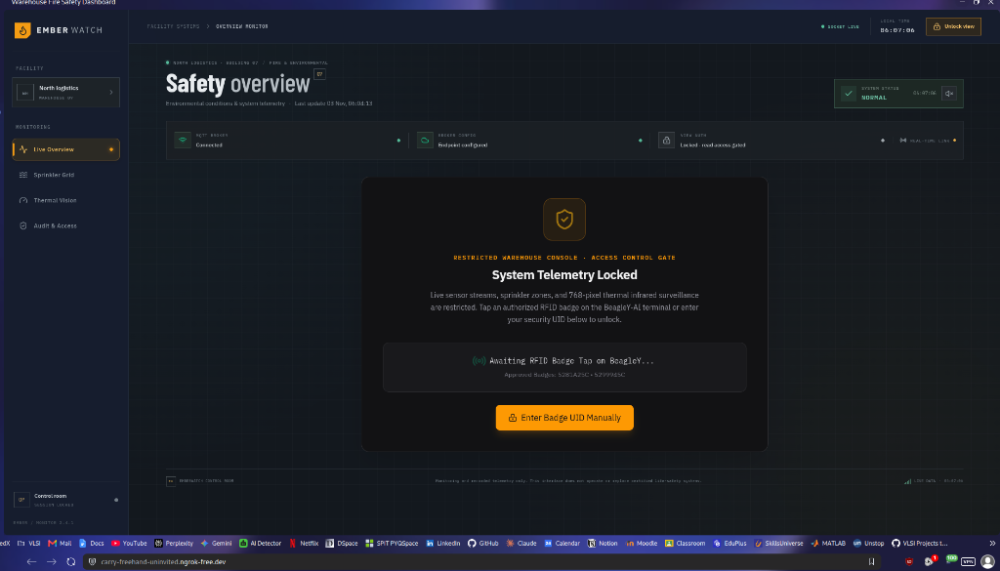
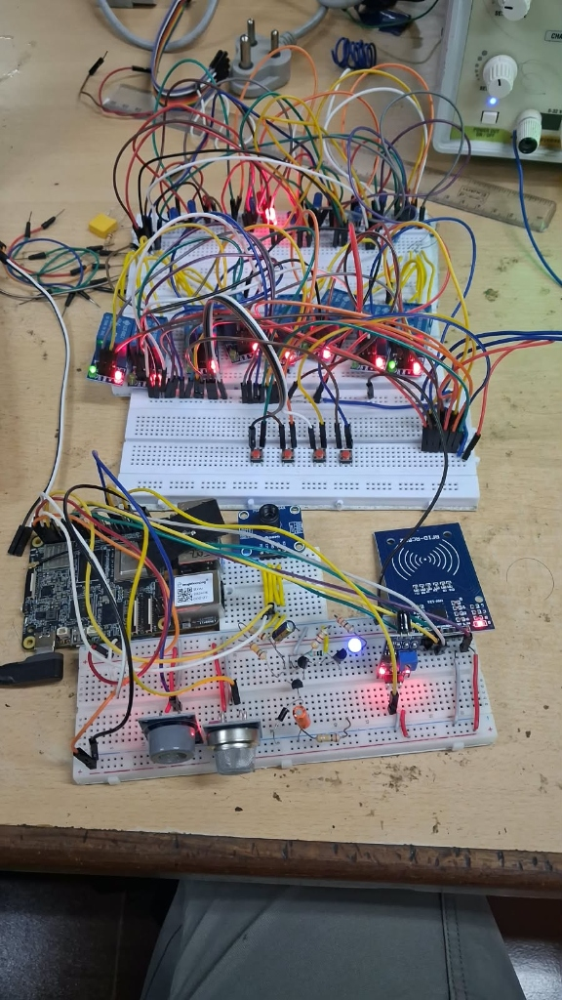
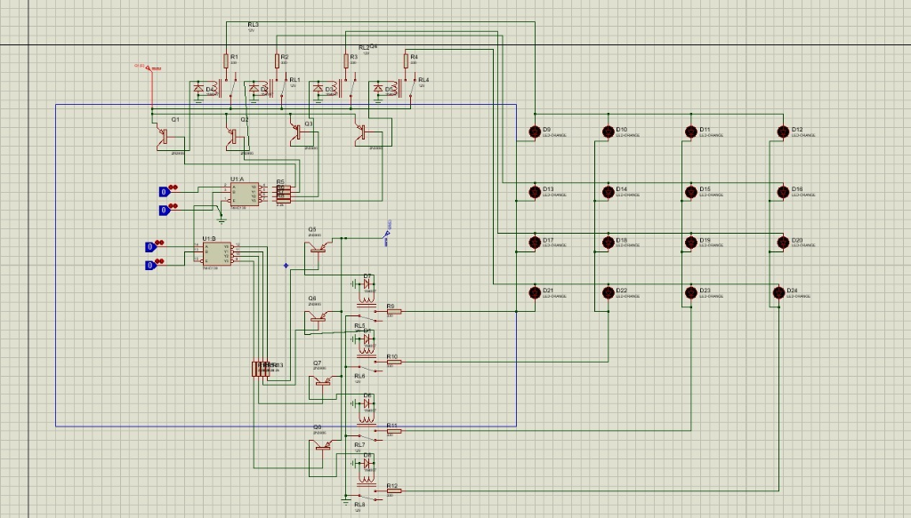
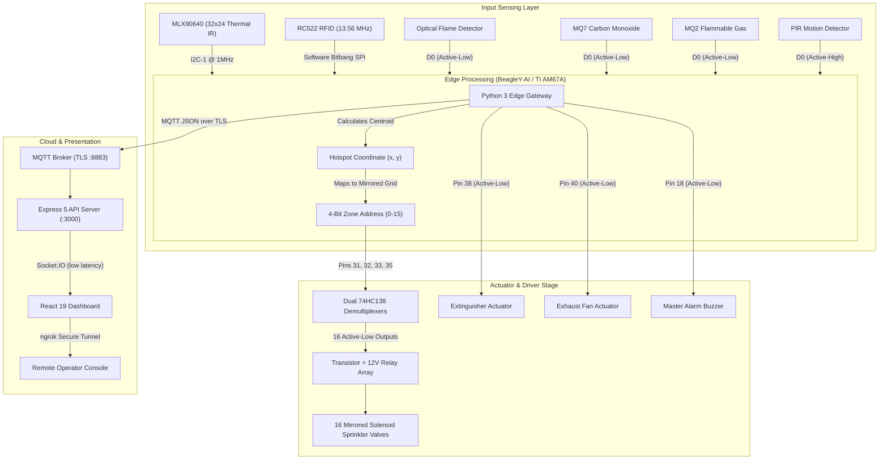

<div align="center">

# EmberWatch
### Autonomous Industrial Fire & Hazardous Environment Suppression System

**A hardware-software edge intelligence system powered by the Texas Instruments AM67A (BeagleY-AI) featuring spatial infrared hotspot localization, active-low relay matrix control, physical RFID console gating, and secure remote access.**

---

[📋 Hardware Specs](docs/HARDWARE_SPEC.md) &bull; [📐 System Architecture](docs/ARCHITECTURE.md) &bull; [📜 Engineering Log](CHANGELOG.md)

</div>

---

## Overview

Industrial warehouses storing volatile chemical, logistical, or combustible inventory face a high risk of localized thermal runaway before sprinkler systems activate. Traditional ceiling sprinkler bulbs only trigger once ambient ceiling air reaches roughly 57-68°C, often too late to stop rapid fire propagation.

**EmberWatch** addresses this with an edge-driven closed-loop architecture:

1. An edge thermal camera continuously reads a **768-point thermal matrix (32 columns × 24 rows)** over I2C.
2. The BeagleY-AI calculates the spatial centroid of any hotspot and translates it into a **4-bit active-low binary address bus**.
3. A custom demultiplexer relay board selects the **single corresponding sprinkler valve** in a mirrored 4 × 4 layout (Zones 01 to 16) before an open flame spreads.
4. Optical infrared flame, toxic carbon monoxide (MQ7), flammable gas (MQ2), and PIR motion sensors provide multi-tier confirmation to reduce false triggers.
5. Telemetry streams via **MQTT over TLS** to a broker and synchronizes with a responsive web dashboard gated by **physical RFID authentication**.

---

## Key Differentiators

- **Pre-Combustion Thermal Spot Localization**: Detects surface overheating and localized thermal anomalies before flame breakout, with sub-second detection latency (limited by the thermal sensor's refresh rate of roughly 8-16 Hz).
- **Physical Hardware Gating**: The dashboard loads in a locked state by default. Live surveillance, thermal imaging, and sprinkler controls stay withheld until an operator taps an authorized 13.56 MHz RFID badge on the reader.
- **Single-Command Edge-to-Cloud Orchestrator (`beagley-connect.sh`)**: One shell command configures USB NAT routing on the host, programs the default gateway on the headless BeagleY-AI, starts edge acquisition services, launches the Express/React stack, and opens an encrypted public tunnel.
- **Remote Access from Any Device**: Tunneled via a persistent ngrok endpoint, so field engineers and plant safety managers can audit telemetry and manually override actuators from a phone or laptop without port forwarding or a static public IP.
- **Active-Low Ground Switching**: The driving stage uses active-low logic, where lines only draw current when asserted to ground. See [Hardware Notes & Known Limitations](#hardware-notes--known-limitations) for the conditions this depends on.
- **Targeted Localized Suppression vs. Flooding**: Traditional systems drench entire warehouse bays, causing heavy inventory water damage. EmberWatch actuates only the single 1 × 1 meter grid zone above the anomaly.

---

## System in Action

<div align="center">

| Operational Overview (Live Telemetry) | Physical RFID Security Lockout Gate |
| :---: | :---: |
|  |  |
| *Real-time environmental feeds, 768-pixel thermal view, and actuator status* | *Restricted console requiring a physical RFID card tap to reveal controls* |

| Mirrored 4×4 Sprinkler Matrix & Hardware Bus | Physical Hardware Implementation |
| :---: | :---: |
|  |  |
| *Active-low bus decoder showing live channel, binary bits, and pin voltages* | *BeagleY-AI, thermal IR, RFID, gas sensors & 16-channel relay array* |

| Proteus Driver Circuit Schematic | Operator Credential Override |
| :---: | :---: |
|  |  |
| *Dual 74HC138 3-to-8 line decoders driving transistor-switched relay coils* | *Fallback manual UID validation interface* |

</div>

---

## System Architecture



---

## 40-Pin Header Connections

Key connections on the BeagleY-AI 40-pin header:

| Group | Function | BeagleY Header Pin | SoC Pin / Line | Electrical Logic |
|:---|:---|:---:|:---|:---|
| **Thermal IR** | MLX90640 Data / Clock | **Pin 3, Pin 5** | `I2C1_SDA`, `I2C1_SCL` | 3.3V I2C (Bus 1 at 0x33) |
| **RFID** | RC522 SPI Bus | **Pins 11, 13, 15, 16, 22** | `CS`, `SCK`, `MOSI`, `MISO`, `RST` | 3.3V Bitbang SPI |
| **Sprinkler Bus** | 4-Bit Binary Address (B0 to B3) | **Pins 31, 32, 33, 35** | `GPIO6`, `12`, `13`, `19` | **Active-Low (Pulls to GND)** |
| **Sensor Inputs** | Flame, MQ7, MQ2, PIR | **Pins 37, 36, 29, 7** | `GPIO26`, `16`, `5`, `4` | Digital Inputs (3.3V max, see notes) |
| **Hazard Outputs** | Fire, Gas, Buzzer Alarms | **Pins 38, 40, 18** | `GPIO20`, `21`, `24` | **Active-Low (Pulls to GND)** |
| **Power & GND** | Logic Power & Ground | **Pins 1, 2, 6, 30, 34** | `3.3V`, `5V`, `GND` | System Power Rails |

*(See [docs/HARDWARE_SPEC.md](docs/HARDWARE_SPEC.md) for full electrical ratings and wiring details.)*

---

## Mirrored 4 × 4 Sprinkler Grid

The physical sprinkler nozzles are arranged in a mirrored grid to match warehouse quadrant plumbing:

$$\begin{matrix} 04 & 03 & 02 & 01 \\ 08 & 07 & 06 & 05 \\ 12 & 11 & 10 & 09 \\ 16 & 15 & 14 & 13 \end{matrix}$$

- **Coordinate Mapping**: The thermal frame is 32 columns wide (x = 0 to 31) and 24 rows tall (y = 0 to 23). For a hotspot (x, y):

  $$\text{col} = \min\left(3, \left\lfloor \frac{x}{8} \right\rfloor\right), \quad \text{row} = \min\left(3, \left\lfloor \frac{y}{6} \right\rfloor\right)$$

  $$\text{Zone ID} = (\text{row} \times 4) + (4 - \text{col}), \quad \text{Channel} = \text{Zone ID} - 1 \quad (0 \le \text{Channel} \le 15)$$

- **Truth Table Summary**:
  - **Zone 01** (Top-Right): Channel `00` (`0000`) → All pins HIGH (3.3V)
  - **Zone 04** (Top-Left): Channel `03` (`0011`) → Pins 31 & 32 LOW (GND), Pins 33 & 35 HIGH (3.3V)
  - **Zone 16** (Bottom-Left): Channel `15` (`1111`) → All pins LOW (GND)

*(See [docs/HARDWARE_SPEC.md](docs/HARDWARE_SPEC.md#5-mirrored-44-sprinkler-grid--active-low-truth-table) for the full 16-zone table.)*

---

## Hardware Notes & Known Limitations

Review these before connecting real valves or suppressant:

- **Idle state and Zone 01**: Channel `00` is encoded as all address pins HIGH, which is also the idle, unpowered, or reset state of the bus. Gate the decoders with an enable line (for example the 74HC138 `E1`/`E2`/`E3` pins) that the edge gateway asserts only when a suppression event is confirmed, and add pull-ups or pull-downs so the enable line has a defined state while the BeagleY-AI boots or is unpowered.
- **Driver polarity**: A 74HC138 drives its selected output LOW. An NPN transistor (such as a 2N3904) turns on when its base goes HIGH, so an NPN stage driven directly from the decoder energizes every *unselected* relay. Use PNP drivers, active-high decoders (74HC238), or an inverting stage, and confirm the polarity against the schematic.
- **5V sensor outputs**: MQ-series modules often output 5V on D0, while the BeagleY-AI GPIO is 3.3V only. Use a level shifter or voltage divider on every sensor input.
- **Flyback protection**: Place a flyback diode across each relay coil.
- **Suppression is not a certified system**: This is a prototype and has not been evaluated to NFPA, FM Global, or equivalent standards. Do not use it as the sole fire protection for a real facility.

---

## Security Notes

- **RFID gating**: The dashboard unlocks on a valid RFID UID read at the reader. UID-only authentication is a single credential, and UIDs on standard 13.56 MHz cards can be cloned, so treat it as a physical convenience gate rather than strong authentication.
- **Keep UIDs private**: Do not commit authorized UIDs to the repository. Supply them at runtime through the `RFID_ALLOWED_UIDS` environment variable, and rotate any UID that has been published.
- **Manual UID fallback**: The typed UID override in the unlock modal should be disabled or protected by a separate password in any deployment reachable from the internet.
- **Protect the tunnel**: A public ngrok endpoint exposes the console to anyone who finds the URL. Enable ngrok authentication (OAuth, basic auth, or IP restrictions) and keep the tunnel domain out of public docs.
- **Use a private, authenticated MQTT broker**: Public brokers such as `broker.emqx.io` are shared, and anyone can subscribe to or publish on guessable topics. Use a private broker with per-device credentials, TLS, and topic ACLs.

---

## Quickstart & Automated Deployment

### The Single-Command Launcher

Connect the BeagleY-AI via USB to your host computer and run:

```bash
./beagley/beagley-connect.sh
```

**What this does automatically:**

1. Verifies the USB link (`192.168.7.2`).
2. Detects the host network interface and enables iptables NAT and kernel IP forwarding so the BeagleY shares the host's internet.
3. Sets default gateway routing on the BeagleY.
4. Restarts `warehouse-publisher.service` to begin MQTT streaming.
5. Starts the Express backend on `:3000` and the Vite dev server on `:5173` (if not already running).
6. Starts the ngrok tunnel and prints the public URL for the live console.

### Manual Build

```bash
# Clone the repository
git clone git@github.com:Pranso141/Warehouse-Fire-Safety-System.git
cd Warehouse-Fire-Safety-System

# Install monorepo dependencies
pnpm install

# Compile all workspaces
pnpm run build

# Start production server (replace placeholders with your own values)
MQTT_URL="mqtts://<your-broker-host>:8883" \
MQTT_USERNAME="<broker-username>" \
MQTT_PASSWORD="<broker-password>" \
RFID_ALLOWED_UIDS="<comma-separated-uids>" \
PORT=3000 pnpm start
```

---

## Repository Structure

```
├── beagley/                     # BeagleY-AI edge drivers & systemd services
│   ├── warehouse_publisher.py   # Sensor acquisition, thermal tracking & MQTT client
│   ├── rc522_driver.py          # Native bitbang SPI driver for RC522 RFID reader
│   └── beagley-connect.sh       # Automated system orchestrator & network bridge
├── artifacts/                   # Core application workspaces
│   ├── api-server/              # Express 5 backend with Socket.IO & MQTT bridge
│   └── warehouse-fire-safety/   # React 19 monitoring console with FLIR Ironbow view
├── docs/                        # Technical documentation & schematics
│   ├── HARDWARE_SPEC.md         # Electrical ratings, pinouts & truth tables
│   ├── ARCHITECTURE.md          # Telemetry schemas, protocols & security states
│   └── assets/                  # Live dashboard captures, testbench photos & schematics
├── CHANGELOG.md                 # Complete development history & milestones
└── README.md                    # Project documentation
```

---

## License

This project is licensed under the [MIT License](LICENSE).
