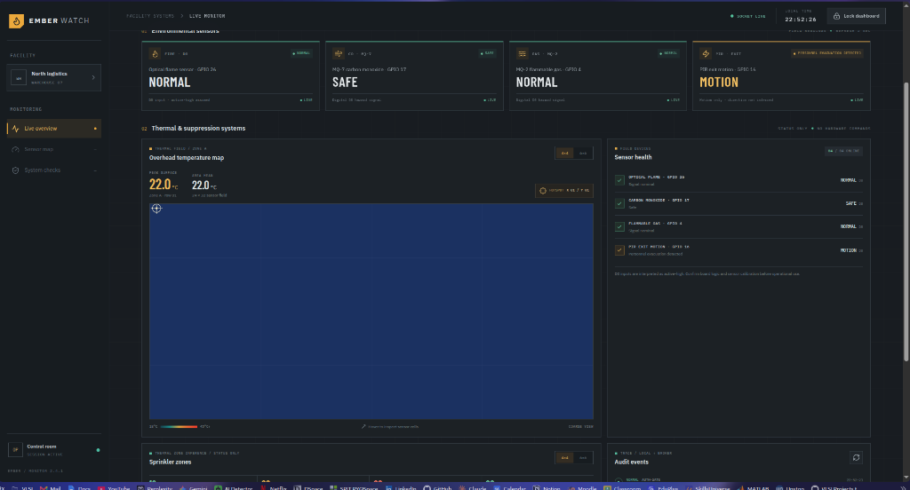
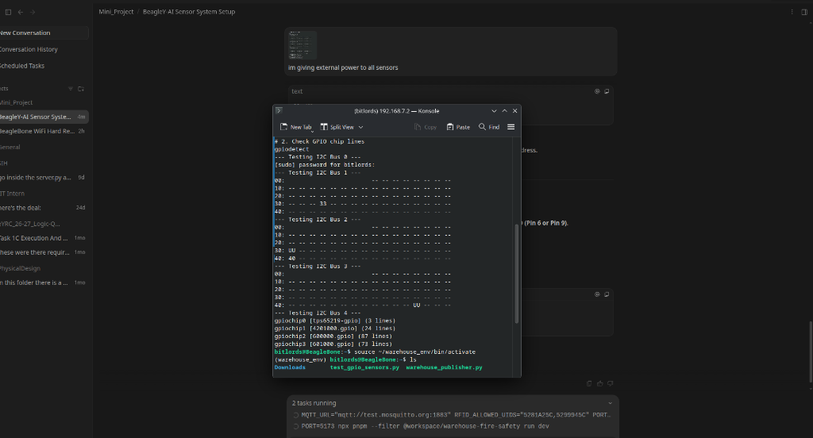
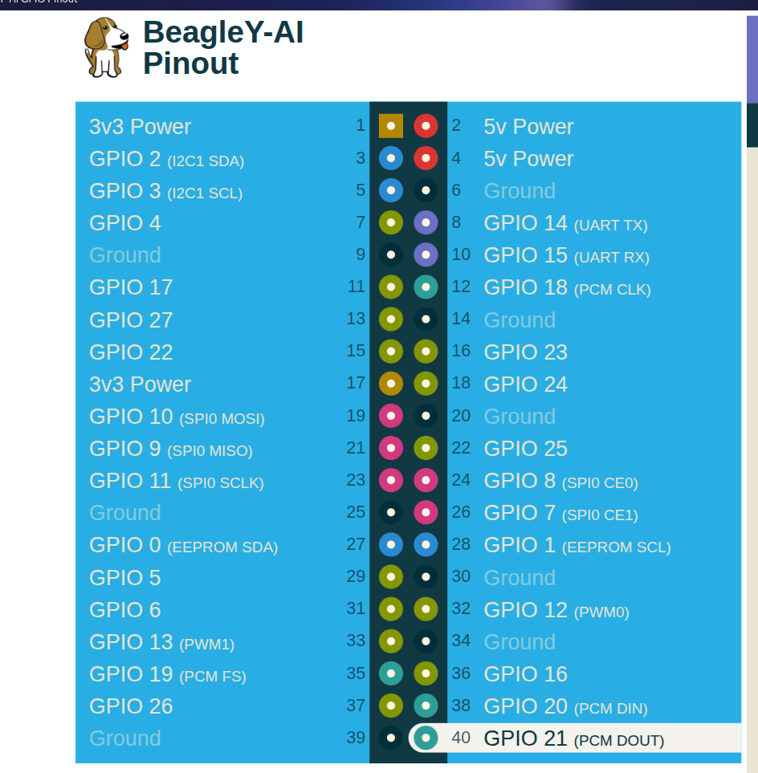
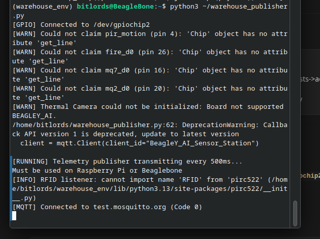

<div align="center">

# 🛡️ EmberWatch: BeagleY-AI Warehouse Fire & Safety System
### Industrial IoT Hazard Detection, Thermal Infrared Vision & 4-Bit Active-Low Sprinkler Grid

[](https://www.typescriptlang.org/)
[](https://react.dev/)
[](https://expressjs.com/)
[](https://www.emqx.io/)
[](https://beagleboard.org/beagley-ai)
[](LICENSE)

**[🌐 Live Demo URL](https://carry-freehand-uninvited.ngrok-free.dev)** &bull; **[📋 Hardware Spec](docs/HARDWARE_SPEC.md)** &bull; **[📐 Architecture Spec](docs/ARCHITECTURE.md)** &bull; **[📜 Changelog](CHANGELOG.md)**

</div>

---

## 📌 Executive Summary

**EmberWatch** is an enterprise-grade, edge-to-cloud industrial warehouse safety monitoring and autonomous fire suppression gateway. Powered by the **BeagleY-AI (Texas Instruments AM67A)** single-board computer, the system continuously aggregates multi-spectral environmental telemetry, tracks high-temperature hotspots via a **768-pixel thermal infrared camera**, enforces physical **RFID access control**, and drives a **4-bit active-low binary sprinkler bus** to actuate physical sprinkler valves in a customized $4 \times 4$ mirrored zone layout.

---

## 📸 System Interface Preview

<div align="center">

| Operational Overview | Thermal Infrared False-Color Vision |
| :---: | :---: |
|  |  |
| *Real-time telemetry, sensor health, and system alarms* | *24×32 thermal heat map with dynamic auto-ranging* |

| Mirrored 4×4 Sprinkler Grid & Bus | Operator Security & RFID Authentication |
| :---: | :---: |
|  |  |
| *Active-low GPIO binary bus (Channels 00–15)* | *Physical badge gating (UIDs: 5281A25C / 5299945C)* |

</div>

---

## ⚡ Core Technical Features

- **MLX90640 768-Pixel Thermal Infrared Vision**:
  - $24 \times 32$ focal plane array operating on BeagleY-AI `/dev/i2c-1` (Address `0x33`).
  - Dynamic Ironbow false-color gradient with bilinear interpolation and floating auto-ranging ($\Delta T \ge 2.5^\circ\text{C}$).
- **Active-Low 4-Bit Binary Sprinkler Matrix**:
  - Mirrored physical layout:
    $$\begin{matrix} 04 & 03 & 02 & 01 \\ 08 & 07 & 06 & 05 \\ 12 & 11 & 10 & 09 \\ 16 & 15 & 14 & 13 \end{matrix}$$
  - Direct hardware pins: **Pin 31 (B0), Pin 32 (B1), Pin 33 (B2), Pin 35 (B3)** pulling to **GND (0V)** when active.
- **Multi-Sensor Environmental Telemetry**:
  - **Flame D0**: High-speed infrared optical flame detector on Pin 37 (`gpiochip2 line 36`).
  - **MQ7 Gas D0**: Carbon monoxide toxic gas monitor on Pin 36 (`gpiochip3 line 7`).
  - **MQ2 Gas D0**: Combustible gas, LPG, and smoke monitor on Pin 29 (`gpiochip3 line 15`).
  - **PIR Motion**: Human evacuation / warehouse zone motion detection on Pin 7 (`gpiochip2 line 38`).
- **Hardware-Level Active-Low Actuators**:
  - **Fire Alarm / Extinguisher Solenoid**: Pin 38 (`gpiochip3 line 10`) pulls to GND on fire detection.
  - **Gas Hazard / Ventilation Fan**: Pin 40 (`gpiochip3 line 9`) pulls to GND on gas leak detection.
  - **Master Alarm Buzzer**: Pin 18 (`gpiochip1 line 10`) pulls to GND on any critical alert.
- **Physical RC522 RFID Access Gating**:
  - Custom bitbang SPI driver operating across split AM67A GPIO controllers.
  - Approved security credentials: `5281A25C` (Manager) and `5299945C` (Inspector).
  - Telemetry is masked in a locked security state until an authorized badge is tapped.
- **Cloud MQTT & WebSocket Synchronization**:
  - Edge gateway streams JSON telemetry to `broker.emqx.io:1883`.
  - Express server bridges telemetry to connected browser clients via Socket.IO with $<25\text{ms}$ latency.

---

## 🔌 Hardware Pinout & Wiring Summary

All connections are mapped to the standard 40-pin header of the BeagleY-AI:

| Pin | BCM GPIO | Controller / Line | Mode | Function | Logic Level |
|:---:|:---|:---|:---:|:---|:---|
| **Pin 1** | `3.3V` | System 3.3V Rail | Power | VCC for MLX90640 & RC522 | 3.3V DC |
| **Pin 2** | `5.0V` | System 5.0V Rail | Power | VCC for MQ7, MQ2, Flame & Relay | 5.0V DC |
| **Pin 3** | `GPIO2` | `I2C1_SDA` | I2C | MLX90640 I2C Data | 3.3V |
| **Pin 5** | `GPIO3` | `I2C1_SCL` | I2C | MLX90640 I2C Clock | 3.3V |
| **Pin 7** | `GPIO4` | `gpiochip2 line 38` | In | PIR Exit Motion Detector | 3.3V Active-High |
| **Pin 11** | `GPIO17` | `gpiochip3 line 8` | Out | RC522 RFID Chip Select (SDA) | Bitbang SPI |
| **Pin 13** | `GPIO27` | `gpiochip2 line 33` | Out | RC522 RFID Serial Clock (SCK) | Bitbang SPI |
| **Pin 15** | `GPIO22` | `gpiochip2 line 41` | Out | RC522 Master Out Slave In (MOSI) | Bitbang SPI |
| **Pin 16** | `GPIO23` | `gpiochip1 line 7` | In | RC522 Master In Slave Out (MISO) | Bitbang SPI |
| **Pin 18** | `GPIO24` | `gpiochip1 line 10` | Out | **Master Hazard Warning Buzzer** | **Active-Low (Pulls to GND)** |
| **Pin 22** | `GPIO25` | `gpiochip2 line 42` | Out | RC522 RFID Hardware Reset (RST) | 3.3V Pulse |
| **Pin 29** | `GPIO5` | `gpiochip3 line 15` | In | **MQ2 Flammable Gas / Smoke D0** | Active-Low / 3.3V |
| **Pin 30** | `GND` | Ground Rail | Ground | Sprinkler Bus Ground Reference | 0V |
| **Pin 31** | `GPIO6` | `gpiochip3 line 17` | Out | **Sprinkler Bus Bit 0 (LSB)** | **Active-Low (Pulls to GND)** |
| **Pin 32** | `GPIO12` | `gpiochip3 line 16` | Out | **Sprinkler Bus Bit 1** | **Active-Low (Pulls to GND)** |
| **Pin 33** | `GPIO13` | `gpiochip3 line 18` | Out | **Sprinkler Bus Bit 2** | **Active-Low (Pulls to GND)** |
| **Pin 35** | `GPIO19` | `gpiochip3 line 12` | Out | **Sprinkler Bus Bit 3 (MSB)** | **Active-Low (Pulls to GND)** |
| **Pin 36** | `GPIO16` | `gpiochip3 line 7` | In | **MQ7 Carbon Monoxide Gas D0** | Active-Low / 3.3V |
| **Pin 37** | `GPIO26` | `gpiochip2 line 36` | In | **Optical Infrared Flame D0** | Active-Low / 3.3V |
| **Pin 38** | `GPIO20` | `gpiochip3 line 10` | Out | **Fire Alarm / Extinguisher Actuator** | **Active-Low (Pulls to GND)** |
| **Pin 40** | `GPIO21` | `gpiochip3 line 9` | Out | **Gas Hazard / Exhaust Fan Actuator** | **Active-Low (Pulls to GND)** |

*(Refer to [docs/HARDWARE_SPEC.md](docs/HARDWARE_SPEC.md) for full electrical ratings and wiring diagrams).*

---

## 📊 4×4 Sprinkler Truth Table (Active-Low)

The active-low binary bus directly addresses channels $0 \dots 15$ corresponding to zones $01 \dots 16$:

$$\text{Zone ID} = (r \times 4) + (4 - c), \quad \text{Channel} = \text{Zone ID} - 1$$

| Zone | Grid Position | Channel | Binary ($B_3 B_2 B_1 B_0$) | Pin 35 ($B_3$) | Pin 33 ($B_2$) | Pin 32 ($B_1$) | Pin 31 ($B_0$) |
|:---:|:---:|:---:|:---:|:---:|:---:|:---:|:---:|
| **Zone 01** | Row 0, Col 3 | `00` | `0000` | 3.3V (HIGH) | 3.3V (HIGH) | 3.3V (HIGH) | 3.3V (HIGH) |
| **Zone 02** | Row 0, Col 2 | `01` | `0001` | 3.3V (HIGH) | 3.3V (HIGH) | 3.3V (HIGH) | **0.0V (GND)** |
| **Zone 03** | Row 0, Col 1 | `02` | `0010` | 3.3V (HIGH) | 3.3V (HIGH) | **0.0V (GND)** | 3.3V (HIGH) |
| **Zone 04** | Row 0, Col 0 | `03` | `0011` | 3.3V (HIGH) | 3.3V (HIGH) | **0.0V (GND)** | **0.0V (GND)** |
| **Zone 05** | Row 1, Col 3 | `04` | `0100` | 3.3V (HIGH) | **0.0V (GND)** | 3.3V (HIGH) | 3.3V (HIGH) |
| **Zone 06** | Row 1, Col 2 | `05` | `0101` | 3.3V (HIGH) | **0.0V (GND)** | 3.3V (HIGH) | **0.0V (GND)** |
| **Zone 07** | Row 1, Col 1 | `06` | `0110` | 3.3V (HIGH) | **0.0V (GND)** | **0.0V (GND)** | 3.3V (HIGH) |
| **Zone 08** | Row 1, Col 0 | `07` | `0111` | 3.3V (HIGH) | **0.0V (GND)** | **0.0V (GND)** | **0.0V (GND)** |
| **Zone 09** | Row 2, Col 3 | `08` | `1000` | **0.0V (GND)** | 3.3V (HIGH) | 3.3V (HIGH) | 3.3V (HIGH) |
| **Zone 10** | Row 2, Col 2 | `09` | `1001` | **0.0V (GND)** | 3.3V (HIGH) | 3.3V (HIGH) | **0.0V (GND)** |
| **Zone 11** | Row 2, Col 1 | `10` | `1010` | **0.0V (GND)** | 3.3V (HIGH) | **0.0V (GND)** | 3.3V (HIGH) |
| **Zone 12** | Row 2, Col 0 | `11` | `1011` | **0.0V (GND)** | 3.3V (HIGH) | **0.0V (GND)** | **0.0V (GND)** |
| **Zone 13** | Row 3, Col 3 | `12` | `1100` | **0.0V (GND)** | **0.0V (GND)** | 3.3V (HIGH) | 3.3V (HIGH) |
| **Zone 14** | Row 3, Col 2 | `13` | `1101` | **0.0V (GND)** | **0.0V (GND)** | 3.3V (HIGH) | **0.0V (GND)** |
| **Zone 15** | Row 3, Col 1 | `14` | `1110` | **0.0V (GND)** | **0.0V (GND)** | **0.0V (GND)** | 3.3V (HIGH) |
| **Zone 16** | Row 3, Col 0 | `15` | `1111` | **0.0V (GND)** | **0.0V (GND)** | **0.0V (GND)** | **0.0V (GND)** |

---

## 🚀 Quick Start & Deployment

### 1. One-Click Automated System Launcher
When connecting the BeagleY-AI over USB, run the automated connect script:
```bash
./beagley/beagley-connect.sh
```
This utility automatically:
1. Detects BeagleY-AI hardware on USB (`192.168.7.2`).
2. Configures dynamic iptables NAT and kernel IP forwarding on your host machine.
3. Sets default gateway routes on BeagleY-AI to share internet access.
4. Restarts `warehouse-publisher.service` to stream live telemetry to `broker.emqx.io`.
5. Starts the Express backend server (`:3000`) and React frontend (`:5173`).
6. Ensures the permanent ngrok tunnel (`carry-freehand-uninvited.ngrok-free.dev`) is active.

### 2. Manual Installation

```bash
# Clone the repository
git clone git@github.com:Pranso141/Warehouse-Fire-Safety-System.git
cd Warehouse-Fire-Safety-System

# Install all workspace dependencies
pnpm install

# Build all monorepo artifacts
pnpm run build

# Start the unified backend and frontend server
MQTT_URL="mqtt://broker.emqx.io:1883" RFID_ALLOWED_UIDS="5281A25C,5299945C" PORT=3000 pnpm start
```

---

## 📜 Repository Structure

```
├── beagley/                     # BeagleY-AI edge drivers & systemd services
│   ├── warehouse_publisher.py   # Hardware acquisition, thermal hotspot & MQTT publisher
│   ├── rc522_driver.py          # Native bitbang SPI driver for RC522 RFID reader
│   └── beagley-connect.sh       # USB NAT orchestrator & multi-service launcher
├── artifacts/                   # Core application monorepo workspaces
│   ├── api-server/              # Express 5 backend with Socket.IO & MQTT bridge
│   └── warehouse-fire-safety/   # React 19 monitoring console with FLIR Ironbow view
├── docs/                        # Deep-dive documentation and specs
│   ├── HARDWARE_SPEC.md         # 40-pin header reference, electrical ratings & truth tables
│   ├── ARCHITECTURE.md          # Telemetry schemas, security state model & protocols
│   └── assets/                  # High-resolution dashboard screenshots & schematics
├── CHANGELOG.md                 # Complete historical engineering log & milestones
├── package.json                 # Monorepo root configuration
└── README.md                    # Main project showcase
```

---

## 🛡️ License

This project is licensed under the **MIT License** — see the [LICENSE](LICENSE) file for details.
