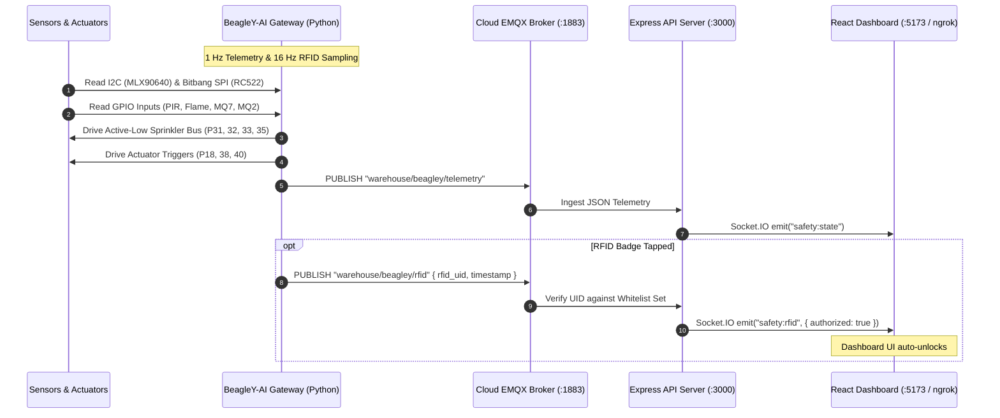
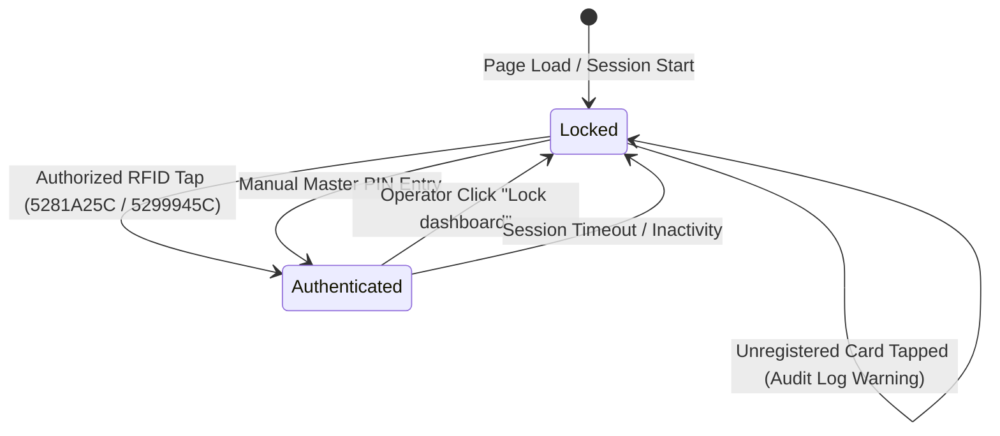

# Software Architecture & Telemetry Pipeline

This document outlines the distributed software architecture, messaging schemas, and real-time event model connecting the BeagleY-AI edge gateway with the cloud MQTT broker, Express API server, and React dashboard.

---

## 1. System Communication Topology



---

## 2. MQTT Telemetry Schema (`warehouse/beagley/telemetry`)

The edge gateway transmits standard JSON telemetry at a deterministic 1.0 Hz cadence:

```json
{
  "sensors": {
    "fire_d0": 0,
    "mq7_d0": 0,
    "mq2_d0": 0,
    "pir_motion": 1
  },
  "thermal": {
    "max_temp": 34.8,
    "avg_temp": 28.2,
    "matrix_24x32": [
      27.5, 27.2, 27.1, 26.9, 27.2, 26.6, 27.1, 26.7,
      27.2, 26.8, 26.8, 27.1, 27.1, 26.8, 27.2, 27.4
      /* ... 768 elements total ... */
    ]
  },
  "sprinkler": {
    "active_zone": 4,
    "channel": 3,
    "binary": "0011",
    "active_low_pins": {
      "pin31_bit0": 0,
      "pin32_bit1": 0,
      "pin33_bit2": 1,
      "pin35_bit3": 1
    }
  },
  "actuators": {
    "fire_alarm_pin38": 1,
    "gas_alarm_pin40": 1,
    "buzzer_pin18": 1
  }
}
```

### Field Definitions:
- `sensors.fire_d0`: `0` = safe, `1` = infrared flame detected.
- `sensors.mq7_d0`: `0` = safe, `1` = toxic CO hazard detected.
- `sensors.mq2_d0`: `0` = safe, `1` = combustible gas/smoke detected.
- `sensors.pir_motion`: `0` = clearance, `1` = personnel movement detected.
- `thermal.matrix_24x32`: Row-major array of 768 float temperatures ($^\circ\text{C}$).
- `sprinkler.active_zone`: Mirrored zone integer ($1 \dots 16$).
- `sprinkler.channel`: 4-bit binary channel ($0 \dots 15$).
- `sprinkler.active_low_pins`: Hardware logic levels (`0` = 0V / GND, `1` = 3.3V / HIGH).

---

## 3. Access Control & Security Model

The dashboard starts in a **Locked Security State** by default on page load to prevent unauthorized operator overrides. 



### Whitelisted Credentials
- `5281A25C`: Tier-1 Logistics Manager Badge
- `5299945C`: Safety Inspector & Response Operator Badge
