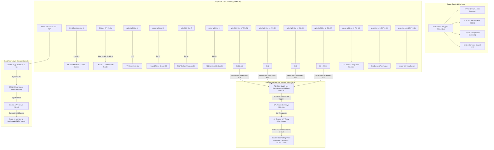
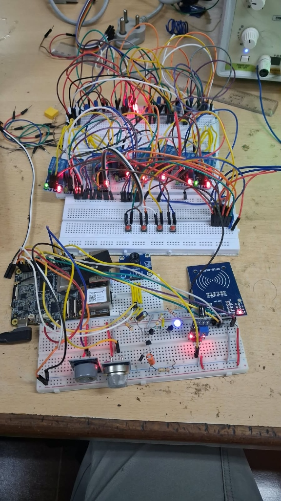
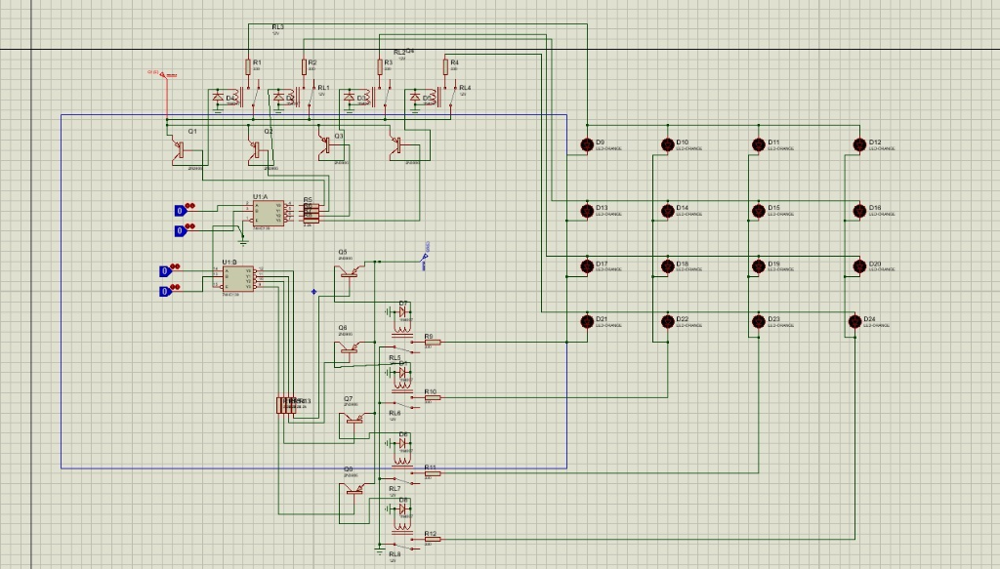

# Hardware Specification & 40-Pin Header Reference

This document provides the complete hardware wiring, pin assignments, electric characteristics, circuit schematics, and signal conditioning for the **BeagleY-AI Warehouse Safety & Fire Suppression Edge Gateway**.

---

## 1. Complete End-to-End System Block Diagram

---

## 2. Physical Hardware Implementation

  
  
<i>Physical hardware test bench: BeagleY-AI single board computer (bottom left), MLX90640 thermal sensor, RC522 RFID reader, MQ2 & MQ7 gas sensors, active-low pull-down conditioning circuitry, and 16-channel relay driver matrix (top).</i>

---

## 3. Sprinkler Matrix Circuit Schematic

The sprinkler driving circuit uses dual **74HC138** 3-to-8 line decoders coupled with **2N3904** switching transistor stages to drive 12V industrial relay coils with flyback protection diodes:

  
  
<i>Proteus schematic: 4-bit digital input lines decode to 16 individual sprinkler zones (D9 to D24) through dual demultiplexers and relay coil drivers.</i>

---

## 4. 40-Pin Header Complete Pinout Matrix

All pin assignments on the BeagleY-AI standard 40-pin header are selected to avoid bus conflicts between I2C, SPI, and GPIO controllers:

| Header Pin | Signal Name | SoC Controller & Line Offset | Direction | Function / Connected Peripheral | Electrical Spec |
|:---:|:---|:---|:---:|:---|:---|
| **Pin 1** | `3.3V Power` | System 3.3V Rail | Power Out | VCC for MLX90640 & RC522 | 3.3V DC (max 500mA) |
| **Pin 2** | `5V Power` | System 5V Rail | Power Out | VCC for MQ7, MQ2, Flame & Relay VCC | 5.0V DC |
| **Pin 3** | `I2C1_SDA` | I2C Controller 1 | Bidirectional | MLX90640 I2C Data | 3.3V Logic |
| **Pin 4** | `5V Power` | System 5V Rail | Power Out | Auxiliary 5V Rail | 5.0V DC |
| **Pin 5** | `I2C1_SCL` | I2C Controller 1 | Output | MLX90640 I2C Clock | 3.3V Logic (1MHz Fast-Mode) |
| **Pin 6** | `GND` | System Ground | Ground | Common Ground | 0V |
| **Pin 7** | `GPIO4` | `gpiochip2 line 38` | Input | PIR Motion Detection (D0) | Active-High / 3.3V |
| **Pin 8** | `GPIO14` | `gpiochip3 line 14` | — | Unassigned / UART TX | — |
| **Pin 9** | `GND` | System Ground | Ground | Common Ground | 0V |
| **Pin 10** | `GPIO15` | `gpiochip3 line 13` | — | Unassigned / UART RX | — |
| **Pin 11** | `GPIO17` | `gpiochip3 line 8` | Output | RC522 Chip Select (SDA/NSS) | 3.3V (Bitbang SPI) |
| **Pin 12** | `GPIO18` | `gpiochip3 line 11` | — | Reserved Audio / Auxiliary | — |
| **Pin 13** | `GPIO27` | `gpiochip2 line 33` | Output | RC522 Serial Clock (SCK) | 3.3V (Bitbang SPI) |
| **Pin 14** | `GND` | System Ground | Ground | Common Ground | 0V |
| **Pin 15** | `GPIO22` | `gpiochip2 line 41` | Output | RC522 Master Out Slave In (MOSI) | 3.3V (Bitbang SPI) |
| **Pin 16** | `GPIO23` | `gpiochip1 line 7` | Input | RC522 Master In Slave Out (MISO) | 3.3V (Bitbang SPI) |
| **Pin 17** | `3.3V Power` | System 3.3V Rail | Power Out | Auxiliary 3.3V Logic Rail | 3.3V DC |
| **Pin 18** | `GPIO24` | `gpiochip1 line 10` | Output | **Master Hazard Alarm / Buzzer** | **Active-Low (Pulls to GND)** |
| **Pin 19** | `GPIO10` | `gpiochip1 line 3` | — | Unassigned SPI0 MOSI | — |
| **Pin 20** | `GND` | System Ground | Ground | Common Ground | 0V |
| **Pin 21** | `GPIO9` | `gpiochip1 line 4` | — | Unassigned SPI0 MISO | — |
| **Pin 22** | `GPIO25` | `gpiochip2 line 42` | Output | RC522 Hardware Reset (RST) | 3.3V Logic Pulse |
| **Pin 23** | `GPIO11` | `gpiochip1 line 2` | — | Unassigned SPI0 SCLK | — |
| **Pin 24** | `GPIO8` | `gpiochip1 line 0` | — | Unassigned SPI0 CE0 | — |
| **Pin 25** | `GND` | System Ground | Ground | Common Ground | 0V |
| **Pin 26** | `GPIO7` | `gpiochip1 line 9` | — | Unassigned SPI0 CE1 | — |
| **Pin 27** | `ID_SD` | I2C EEPROM | — | System Board ID Data | Reserved |
| **Pin 28** | `ID_SC` | I2C EEPROM | — | System Board ID Clock | Reserved |
| **Pin 29** | `GPIO5` | `gpiochip3 line 15` | Input | **MQ2 Flammable Gas Sensor D0** | Active-Low / 3.3V |
| **Pin 30** | `GND` | System Ground | Ground | **Sprinkler Bus Ground Return** | 0V |
| **Pin 31** | `GPIO6` | `gpiochip3 line 17` | Output | **Sprinkler Bus Bit 0 (LSB)** | **Active-Low (Pulls to GND)** |
| **Pin 32** | `GPIO12` | `gpiochip3 line 16` | Output | **Sprinkler Bus Bit 1** | **Active-Low (Pulls to GND)** |
| **Pin 33** | `GPIO13` | `gpiochip3 line 18` | Output | **Sprinkler Bus Bit 2** | **Active-Low (Pulls to GND)** |
| **Pin 34** | `GND` | System Ground | Ground | **Sprinkler Bus Ground Return** | 0V |
| **Pin 35** | `GPIO19` | `gpiochip3 line 12` | Output | **Sprinkler Bus Bit 3 (MSB)** | **Active-Low (Pulls to GND)** |
| **Pin 36** | `GPIO16` | `gpiochip3 line 7` | Input | **MQ7 Carbon Monoxide Sensor D0** | Active-Low / 3.3V |
| **Pin 37** | `GPIO26` | `gpiochip2 line 36` | Input | **Optical Flame Sensor D0** | Active-Low / 3.3V |
| **Pin 38** | `GPIO20` | `gpiochip3 line 10` | Output | **Fire Alarm / Extinguisher Actuator** | **Active-Low (Pulls to GND)** |
| **Pin 39** | `GND` | System Ground | Ground | Actuator Common Ground | 0V |
| **Pin 40** | `GPIO21` | `gpiochip3 line 9` | Output | **Gas Hazard / Exhaust Fan Actuator** | **Active-Low (Pulls to GND)** |

---

## 5. Mirrored 4×4 Sprinkler Grid & Active-Low Truth Table

The physical suppression matrix is deployed as a 16-zone mirrored layout:

$$\begin{matrix} 04 & 03 & 02 & 01 \\ 08 & 07 & 06 & 05 \\ 12 & 11 & 10 & 09 \\ 16 & 15 & 14 & 13 \end{matrix}$$

### Coordinate Mapping Formula
For thermal camera hotspot $(x, y)$ where $x \in [0, 31]$ and $y \in [0, 23]$:
$$c = \min\left(3, \left\lfloor \frac{x}{32} \times 4 \right\rfloor\right), \quad r = \min\left(3, \left\lfloor \frac{y}{24} \times 4 \right\rfloor\right)$$
$$\text{Zone ID} = (r \times 4) + (4 - c)$$
$$\text{Channel} = \text{Zone ID} - 1 \quad (0 \le \text{Channel} \le 15)$$

### Complete Binary & Electrical Truth Table

> **Active-Low Logic**: In active-low switching, bit `1` pulls the pin to **0V (GND)**, completing the circuit for relay coils or demultiplexer inputs. Bit `0` holds the pin at **3.3V (HIGH)**.

| Zone | Grid Position | Channel | Binary ($B_3 B_2 B_1 B_0$) | Pin 35 ($B_3$) | Pin 33 ($B_2$) | Pin 32 ($B_1$) | Pin 31 ($B_0$) |
|:---:|:---:|:---:|:---:|:---:|:---:|:---:|:---:|
| **Zone 01** | Row 0, Col 3 | `00` | `0000` | 3.3V (HIGH) | 3.3V (HIGH) | 3.3V (HIGH) | 3.3V (HIGH) |
| **Zone 02** | Row 0, Col 2 | `01` | `0001` | 3.3V (HIGH) | 3.3V (HIGH) | 3.3V (HIGH) | **0.0V (GND)** |
| **Zone 03** | Row 0, Col 1 | `02` | `0010` | 3.3V (HIGH) | 3.3V (HIGH) | **0.0V (GND)** | 3.3V (HIGH) |
| **Zone 04** | Row 0, Col 0 | `03` | `0011` | 3.3V (HIGH) | 3.3V (HIGH) | **0.0V (GND)** | **0.0V (GND)** |
| **Zone 05** | Row 1, Col 3 | `04` | `0100` | 3.3V (HIGH) | **0.0V (GND)** | 3.3V (HIGH) | 3.3V (HIGH) |
| **Zone 06** | Row 1, Col 2 | `05` | `0101` | 3.3V (HIGH) | **0.0V (GND)** | 3.3V (HIGH) | **0.0V (GND)** |
| **Zone 07** | Row 1, Col 1 | `06` | `0110` | 3.3V (HIGH) | **0.0V (GND)** | **0.0V (GND)** | 3.3V (HIGH) |
| **Zone 08** | Row 1, Col 0 | `07` | `0111` | 3.3V (HIGH) | **0.0V (GND)** | **0.0V (GND)** | **0.0V (GND)** |
| **Zone 09** | Row 2, Col 3 | `08` | `1000` | **0.0V (GND)** | 3.3V (HIGH) | 3.3V (HIGH) | 3.3V (HIGH) |
| **Zone 10** | Row 2, Col 2 | `09` | `1001` | **0.0V (GND)** | 3.3V (HIGH) | 3.3V (HIGH) | **0.0V (GND)** |
| **Zone 11** | Row 2, Col 1 | `10` | `1010` | **0.0V (GND)** | 3.3V (HIGH) | **0.0V (GND)** | 3.3V (HIGH) |
| **Zone 12** | Row 2, Col 0 | `11` | `1011` | **0.0V (GND)** | 3.3V (HIGH) | **0.0V (GND)** | **0.0V (GND)** |
| **Zone 13** | Row 3, Col 3 | `12` | `1100` | **0.0V (GND)** | **0.0V (GND)** | 3.3V (HIGH) | 3.3V (HIGH) |
| **Zone 14** | Row 3, Col 2 | `13` | `1101` | **0.0V (GND)** | **0.0V (GND)** | 3.3V (HIGH) | **0.0V (GND)** |
| **Zone 15** | Row 3, Col 1 | `14` | `1110` | **0.0V (GND)** | **0.0V (GND)** | **0.0V (GND)** | 3.3V (HIGH) |
| **Zone 16** | Row 3, Col 0 | `15` | `1111` | **0.0V (GND)** | **0.0V (GND)** | **0.0V (GND)** | **0.0V (GND)** |
